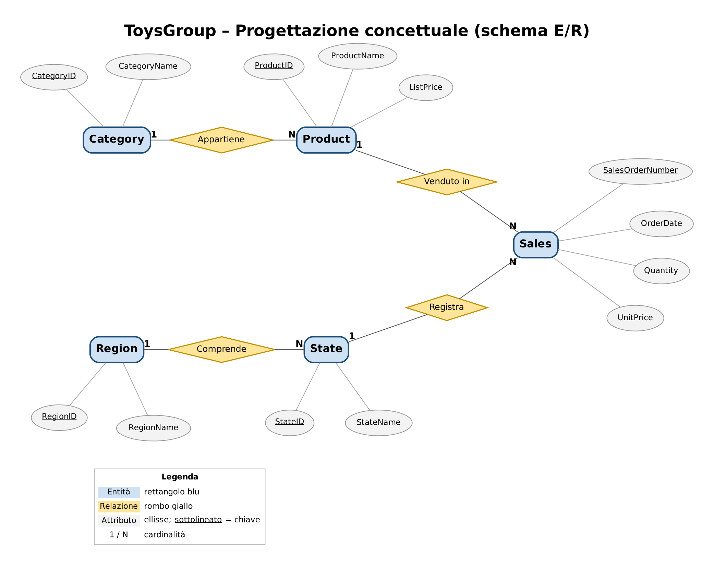
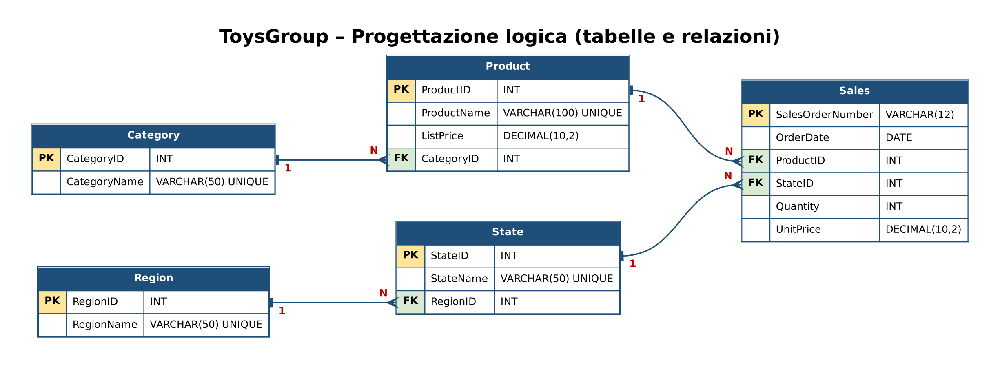

# 🗄️ SQL: database ToysGroup

Esame finale del **Modulo 2 – SQL** del Master Data Analyst di Epicode.

**Autore:** Francesco Autorino

> 📋 La traccia completa dell'esercizio è in [TRACCIA.md](TRACCIA.md).

## 🎯 Il progetto

ToysGroup distribuisce giocattoli in diverse aree del mondo. I prodotti sono divisi in **categorie** e i mercati in
**regioni di vendita**, che raggruppano più **stati**. Ho progettato e realizzato in **MySQL** il database delle
vendite, garantendo l'integrità referenziale e riducendo al minimo la ridondanza dei dati.

## 📁 File

| File | Contenuto |
|---|---|
| `TEORIA.md` | Le risposte alle 12 domande di teoria |
| `Task1_SchemaConcettuale.png` | Task 1: lo schema E/R con entità, relazioni, attributi e cardinalità |
| `Task1_SchemaLogico.png` | Task 1: le tabelle con colonne, tipi, chiavi primarie ed esterne |
| `ToysGroup.sql` | Task 2-4: creazione delle tabelle, popolamento, query di analisi e viste |
| `README.md` | Questo file, con la spiegazione della progettazione |

Lo script `.sql` è commentato passo per passo e si esegue dall'inizio alla fine: ricrea il database da zero.

## 🧩 Task 1 – Progettazione concettuale

Le entità della traccia sono Product, Region e Sales. Le due gerarchie (prodotto → categoria e stato → regione)
diventano entità separate, così il nome di una categoria o di una regione è scritto una volta sola.

| Entità | Chiave | Attributi principali |
|---|---|---|
| Category | CategoryID | nome della categoria |
| Product | ProductID | nome, prezzo di listino |
| Region | RegionID | nome della regione di vendita |
| State | StateID | nome dello stato |
| Sales | SalesOrderNumber | data, quantità, prezzo unitario |

**Cardinalità**
- una categoria contiene **molti** prodotti; un prodotto appartiene a **una sola** categoria;
- un prodotto compare in **zero o molte** vendite; ogni vendita riguarda **un solo** prodotto;
- una regione comprende **molti** stati; uno stato appartiene a **una sola** regione;
- uno stato registra **zero o molte** vendite; ogni vendita avviene in **un solo** stato, quindi in una sola regione.

## 🗂️ Task 1 – Progettazione logica

**Scelte di progettazione**
- `Sales` è collegata allo **stato**, non direttamente alla regione: la regione si ricava dallo stato, quindi non
  la ripeto in ogni vendita;
- `UnitPrice` in `Sales` salva il prezzo al momento della vendita, che può essere diverso dal listino attuale;
- il **fatturato** non è una colonna, ma si calcola nelle query (`Quantity * UnitPrice`), così non può mai essere
  in disaccordo con i dati;
- vincoli `UNIQUE` sui nomi e `CHECK` su quantità e prezzi impediscono dati incoerenti.

## 🔍 Task 4 – Le query

| N. | Domanda | Come l'ho risolta |
|---|---|---|
| 1 | Le chiavi primarie sono univoche? | `GROUP BY` + `HAVING COUNT(*) > 1` per ogni tabella, più un riepilogo con `COUNT(DISTINCT)` |
| 2 | Elenco delle transazioni con il flag dei 180 giorni | `JOIN` di tutte le tabelle e `DATEDIFF(CURRENT_DATE, OrderDate) > 180` |
| 3 | Prodotti sopra la media dell'ultimo anno | `HAVING` con una subquery che calcola la media, e un'altra che trova l'ultimo anno |
| 4 | Fatturato per anno dei soli prodotti venduti | `JOIN` interna, che esclude da sola i prodotti senza vendite |
| 5 | Fatturato per stato e per anno | `GROUP BY` stato e anno, ordinato per anno e fatturato decrescente |
| 6 | Categoria più richiesta | pezzi venduti per categoria, confrontati con il massimo (così gestisco anche i pareggi) |
| 7 | Prodotti invenduti | due approcci: `LEFT JOIN ... IS NULL` e `NOT EXISTS` |
| 8 | Vista denormalizzata dei prodotti | `vw_Product`: codice, nome e categoria |
| 9 | Vista geografica | `vw_Geography`: ogni stato con la sua regione |

## 📊 Alcuni risultati

Con i dati di esempio (25 vendite tra il 2024 e il 2026):
- la categoria più richiesta è **Outdoor Toys**, con 59 pezzi venduti;
- i prodotti invenduti sono **Bike Gloves L**, **Chess Junior** e **Garden Tent**;
- la media dei pezzi per vendita nell'ultimo anno (2026) è 6: sei prodotti hanno venduto in totale più di 6 pezzi.

[⬅️ Torna all'indice del Master](../README.md)
