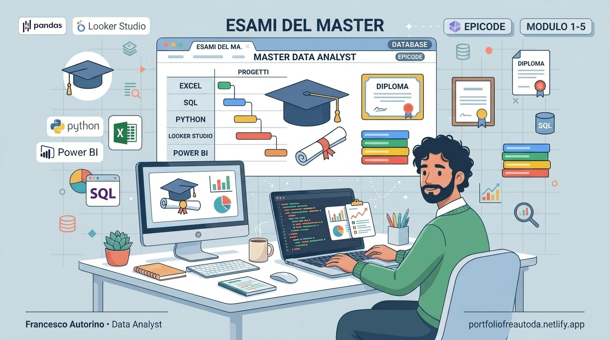

# 🎓 Master Data Analyst – Epicode

**Francesco Autorino**

In questo repository raccolgo gli esami finali dei moduli del Master Data Analyst di Epicode, in ordine di corso.
Ogni cartella ha un README che spiega il progetto.

| Modulo | Strumento | Progetto | Cartella |
|---|---|---|---|
| 1 | 📗 Excel | Gestione delle strutture ricettive delle Marche: maschera di ricerca e tabella pivot | [Modulo1_Excel](Modulo1_Excel) |
| 2 | 🗄️ SQL | Database delle vendite ToysGroup: progettazione, creazione e popolamento delle tabelle, query di analisi e viste, teoria | [Modulo2_SQL](Modulo2_SQL) |
| 3 | 🐍 Python | Analisi della diffusione del COVID-19 nel mondo e in Europa | [Modulo3_Python](Modulo3_Python) |
| 4 | 🎤 Looker Studio | Sanremo 1951-2023, dal palco a Spotify | [Modulo4_LookerStudio](Modulo4_LookerStudio) |
| 5 | 📊 Power BI | Olist, e-commerce brasiliano 2016-2018: ordini, ricavi e rating, con star schema e confronto con l'anno precedente | [Modulo5_PowerBI](Modulo5_PowerBI) |

## 🏁 Progetto finale

Il Capstone Project del Master, sul successo di film e serie TV tra il 2000 e il 2025 (rating IMDb e premi Oscar,
Golden Globe ed Emmy, con Python e Power BI), è in un repository dedicato:

👉 [CapstoneProjectDataAnalystAutorinoEpicode](https://github.com/FreAuto/CapstoneProjectDataAnalystAutorinoEpicode)
